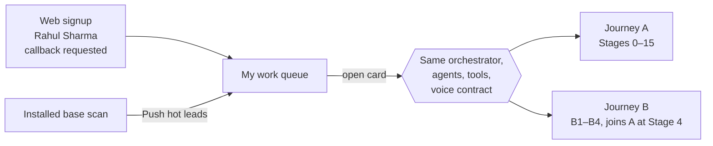

# Agentic Org: TVS Customer Journey OS
## POC Scope v2: live agents, real calls

| | |
|---|---|
| **Client** | TVS Motor Company, two-wheeler retail (reference dealership: TVS Kothrud, Pune) |
| **Document** | POC scope, version 2. Supersedes the scripted v1 scope in [business-scope.md](business-scope.md) §4–5 |
| **Status** | Draft for team review · 13 October 2026 |
| **Team** | Sagar · Maheb · Parth · Mansi |
| **Companion documents** | [Concept note](concept-note.md) · [Business scope (v1)](business-scope.md) · [Architecture](architecture.md) · [Infrastructure BOM](infrastructure-bom.md) |

---

### Contents

1. [Summary](#1-summary)
2. [What changes from v1](#2-what-changes-from-v1)
3. [Principles](#3-principles)
4. [Cast](#4-cast)
5. [Two entry points, one backend](#5-two-entry-points-one-backend)
6. [Journey A: new enquiry to serviced owner](#6-journey-a-new-enquiry-to-serviced-owner)
7. [Journey B: installed-base owner to EV conversation](#7-journey-b-installed-base-owner-to-ev-conversation)
8. [Calls](#8-calls)
9. [Self-paced journey and visible thinking](#9-self-paced-journey-and-visible-thinking)
10. [Time in the demo](#10-time-in-the-demo)
11. [Voice pipeline: abstract contract](#11-voice-pipeline-abstract-contract)
12. [Deterministic tools](#12-deterministic-tools)
13. [State, persistence and replay](#13-state-persistence-and-replay)
14. [Team workstreams](#14-team-workstreams)
15. [Telephony, compliance and security](#15-telephony-compliance-and-security)
16. [In scope / out of scope](#16-in-scope--out-of-scope)
17. [Running the demo](#17-running-the-demo)
18. [Phases and exit criteria](#18-phases-and-exit-criteria)
19. [Risks](#19-risks)
20. [Open decisions](#20-open-decisions)
21. [Appendix](#21-appendix)

---

### 1. Summary

v1 proved the idea with a scripted, click-through journey. v2 makes it real. **AI agents phone the
customer, hold the conversation, reason over what they heard, hand work to each other and move the
journey forward on their own.** A human operator approves every consequential decision and authorises
every outbound call.

On the day, the presenter plays the customer on a real phone. Each call's transcript appears live in
the dashboard. When the customer hangs up, the agents reason about the call, update the customer graph
with evidence, and move the journey to the next stage. Any call can instead be **simulated** with a
scripted, known-good conversation, so the demo never depends on every call going perfectly.

The voice pipeline (telephony, speech and model) is **deliberately abstract** in this scope. Several
stacks are being prototyped in parallel (§14). They all plug into the same contract (§11), so the
journey, the UI and the agents do not change when the pipeline does.

### 2. What changes from v1

| Concern | v1 (as built) | v2 (this scope) |
|---|---|---|
| Customer conversations | Pre-written transcripts | Live phone calls with AI agents, or a scripted simulation per call |
| Reasoning, extraction, persona | Fixtures | LLM over the real transcript, with evidence quotes |
| Navigation | `Continue` button, one slide per stage | Self-paced. The orchestrator advances when a call ends, reasoning finishes or a human decides |
| Agents | Labels on activity entries | Named AI agents with distinct voices and scopes |
| Time | Implied | Simulated clock with explicit time-skips (test ride, delivery, 40 days of riding) |
| Entry points | Inbound call only | Web signup (new lead) **and** installed-base outreach |
| Stages | 18 (incl. insurance renewal, Diwali campaign) | 16 (Stages 0–15). Insurance and campaign cut; financing commit moved after the revised recommendation |
| Undo / scrub | Full undo of any decision | Read-only history in live mode (a call cannot be un-made); full replay of a recorded run |

### 3. Principles

1. **The LLM talks and reasons. Tools compute.** Prices, EMIs, ranges, scores, eligibility, slots and
   due dates come only from deterministic tools (§12). An agent may *say* a number only if a tool
   produced it during this run.
2. **The graph is the product.** Every write carries the agent that made it, the evidence (a quote or
   a rule) and a confidence score. Old values are superseded, never deleted.
3. **Agents prepare. Humans authorise.** No outbound call and no commitment (recommendation, loan,
   order) happens without an operator click.
4. **Agents hand off typed objects, not chat.** Meera → Maheb, Maheb → Meera and Arjun → Meera
   exchange structured requests with a scoped context.
5. **Pipeline-agnostic.** Journey logic never imports a telephony or speech SDK. It talks to the voice
   contract (§11).
6. **Demo-safe by construction.** Every call can be live or simulated. Every run is recorded as an
   event log that can be replayed.
7. **Honest agents.** They say they are AI, announce recording, never invent facts, and say "I'll
   confirm that" instead of guessing.

### 4. Cast

#### AI agents

| Agent | Name | Voice | Owns | Calls the customer | Never does |
|---|---|---|---|---|---|
| Sales | **AI Meera** | Female | Discovery, persona, product match, recommendation, test ride, revised recommendation | Calls 1, 2, 3 and B2 | Quote a number no tool produced; commit a recommendation |
| Finance | **AI Maheb** | Female | Eligibility (abstracted), lender panel, EMI structures, finance call | Call 4 | Commit a loan; discuss credit details beyond "eligible" |
| Engagement | **AI Arjun** | Male | Installed-base outreach, hot-lead push, accessories | Calls B1 and 5 | Pitch a sale on a service call without consent |
| Service | **AI Sagar** | Male | Service due, pickup and drop, workshop updates, post-service feedback | Calls 6, 7, 8 | Promise work the workshop has not confirmed |
| Orchestrator | — (no voice) | — | Stage state machine, handoffs, clock, approval gates, graph write-back | Never | — |

#### Humans

| Role | Who on the day | Does |
|---|---|---|
| **Customer** | The presenter, on their own phone, following a persona card (Appendix A) | Takes the live calls and answers as the persona |
| **Sales manager (operator)** | A teammate at the dashboard | Places or simulates calls; approves, modifies, escalates or rejects decisions; can pause the journey |

### 5. Two entry points, one backend



- **A. New lead.** Rahul Sharma filled in the iQube enquiry form on the TVS website and ticked
  "request a callback". He appears in the work queue as a new web lead.
- **B. Existing owner.** On the installed-base screen, the operator clicks **Push hot leads**. AI Arjun
  pushes the top two petrol owners by EV-readiness score into the work queue, and their cards pop in.
  This is indicative: the ranking is the existing explainable score (§12), not an ML model.

### 6. Journey A: new enquiry to serviced owner

The sim clock is described in §10. "Gate" means the orchestrator waits for the operator.

| Stage | What happens | Agent | Trigger | Call | Gate | Sim clock |
|---|---|---|---|---|---|---|
| 0 | Web lead lands in the queue | Orchestrator | Signup event | — | — | Day 0 · 10:02 |
| 1 | Discovery call | Meera | **Operator: Place / Simulate** | **1** | Call authorisation | Day 0 · 10:06 |
| 2 | Extraction: typed requirements, each anchored to a quote | Meera | Call ended | — | — | Day 0 · 10:12 |
| 3 | Persona formation, with confidence and evidence | Meera | Auto | — | — | Day 0 · 10:13 |
| 4 | Product match: six variants scored by tool | Meera | Auto | — | — | Day 0 · 10:14 |
| 5 | Approve the recommendation | Operator | Decision | — | **Approve / Modify / Escalate / Reject** | Day 0 · 10:20 |
| 6 | Recommendation explained, objections handled, test ride booked | Meera | **Operator: Place / Simulate** | **2** | Call authorisation | Day 0 · 15:30 |
| ⏩ | *Test ride happens at TVS Kothrud (DMS check-in event)* | — | Time-skip | — | — | Day 5 · Sat 11:00 |
| 7 | Ride debrief. Persona corrected (old values kept) | Meera | **Operator: Place / Simulate** | **3** | Call authorisation | Day 5 · 13:00 |
| 8 | Handoff: Meera → Maheb (`FinanceRequest`) | Meera, Orchestrator | Auto | — | — | Day 5 · 13:10 |
| 9 | Lender panel: eligibility (abstract), three structures, EMI maths | Maheb | Auto | — | — | Day 5 · 13:12 |
| 10 | Finance options call. The customer may re-frame the budget or ask about more range | Maheb | **Operator: Place / Simulate** | **4** | Call authorisation | Day 6 · 18:00 |
| 11 | Handoff Maheb → Meera; re-score; revised recommendation (or "holds") | Meera, Maheb | Auto, then decision | — | **Approve upgrade / Keep** | Day 6 · 18:15 |
| 12 | Commit financing for the final variant | Operator | Decision | — | **Commit / Choose other lender / Escalate** | Day 7 · 10:00 |
| 13 | Sale closes: order, registration number, delivery date | Orchestrator | Auto | — | — | Day 8 · 11:00 |
| 14 | Accessories: Arjun reasons from the graph and proposes picks *and* declines; operator approves; Arjun calls before delivery | Arjun | Reason → **Approve** → **Place / Simulate** | **5** | Approval + call authorisation | Day 8 · 16:00 |
| ⏩ | *Delivery, then ~40 days of commuting (telemetry ticks: odometer, charge cycles, battery SoH)* | — | Time-skip | — | — | Day 49 · ~1,400 km |
| 15a | First service due (1,500 km / 90 days rule); pickup offered | Sagar | **Operator: Place / Simulate** | **6** | Call authorisation | Day 49 · 10:00 |
| ⏩ | *Pickup; workshop updates arrive as DMS events (checked in → battery test → done)* | — | Time-skip | — | — | Day 51 · 09:00–16:00 |
| 15b | Vehicle ready: work summary, drop-off time | Sagar | **Operator: Place / Simulate** | **7** | Call authorisation | Day 51 · 16:30 |
| 15c | Post-service feedback; journey closes as *serviced, engaged owner* | Sagar | **Operator: Place / Simulate** | **8** | Call authorisation | Day 52 · 11:00 |

**Story-continuity rules (fixes to v1):**
- Rahul is reached by an **outbound** call after a web signup. There is no inbound call.
- Speakers are AI agents, never "advisor Meera K.". The finance call is Maheb's, not Meera's.
- Financing is committed only **after** the recommendation is final (v1 committed it first).
- Mileage is consistent with the stated commute: ~35 km/day × ~40 days ≈ 1,400 km at the first service.
- Insurance renewal (impossible for a new vehicle) and the Diwali campaign are cut.
- Every fact used later must have been said on a call or produced by a tool. Example: "prefers
  evenings" exists only if the customer said it.
- The upgrade storyline (3.5 kWh → S 4.7 kWh) happens only if the customer says the right things on
  Calls 3 and 4 (Appendix A). Otherwise the "recommendation holds" branch runs, which is equally valid.

### 7. Journey B: installed-base owner to EV conversation

| Step | What happens | Agent | Call | Gate |
|---|---|---|---|---|
| B0 | **Push hot leads:** the top two owners by EV-readiness score pop into the queue with their score and reason | Arjun | — | Operator click |
| B1 | **Ownership check-in.** Arjun calls about the customer's *current petrol scooter*: age, service record, roughly what it costs to run. **No sales pitch.** He closes by asking whether the customer would like a call from an EV specialist | Arjun | **B1** | **Place / Simulate** |
| B2 | **Handshake:** if the customer said yes, Arjun emits an `EngagementReferral` (vehicle facts from the CRM, what the customer confirmed, fuel spend, consent with timestamp and wording). If they said no, the journey ends politely and the record is updated | Arjun → Meera | — | — |
| B3 | **Continued conversation.** Meera calls with Arjun's context ("Arjun mentioned you spend about ₹1,800 a month on petrol…") and asks only what is still unknown | Meera | **B2** | **Place / Simulate** |
| B4 | Joins Journey A at **Stage 4** (product match). The old scooter's exchange value is an extra input to finance | Meera → … | as A | as A |

The recommended demo cut for B is to stop at test-ride booking (Stage 6). The point of B is the warm
entry and the handshake, not a second full lifecycle.

### 8. Calls

#### 8.1 Call inventory

| # | Call | Agent | Goal | Must capture (structured outcome) | Target length |
|---|---|---|---|---|---|
| 1 | Discovery | Meera | Understand the need. No recommendation, no numbers | Use case, daily km, current vehicle and exchange, concerns, budget, cash or finance, monthly ceiling, urgency, variant in mind, test-ride availability | ~2.5 min |
| 2 | Recommendation + booking | Meera | Explain the approved variant in the customer's terms; book a slot | Accepted?, objections, booking (id, centre, slot) | ~1.5 min |
| 3 | Ride debrief | Meera | What changed after riding | Impressions, revised preferences (technology, range), open doubts | ~1.5 min |
| 4 | Finance options | Maheb | Walk through three structures | Preferred structure, monthly limit, budget re-framing, upgrade interest | ~2 min |
| 5 | Accessories | Arjun | Offer the approved fitment before delivery | Accepted and declined items, with reasons | ~1.5 min |
| 6 | Service booking | Sagar | First service due; offer pickup | Slot, pickup confirmation, issues reported | ~1 min |
| 7 | Vehicle ready | Sagar | Work summary, drop-off | Drop-off confirmed, questions | ~1 min |
| 8 | Post-service feedback | Sagar | Satisfaction | Rating, comments, open issue? | ~1 min |
| B1 | Ownership check-in | Arjun | Service relationship; ask consent | Confirmed facts, consent yes or no | ~1.5 min |
| B2 | EV conversation | Meera | Continue from the referral | As Call 1, pre-filled | ~2 min |

#### 8.2 Every call follows the same pattern

- **Before:** the agent receives its persona and voice, the call goal, the talkativity level, the
  graph snapshot, **all earlier transcripts with this customer**, any handoff object, and the tools it
  may use during the call.
- **During:** both sides are transcribed live into the dashboard's conversation thread. Tool calls
  (e.g. `book_test_ride`, `compute_emi`) show as events.
- **After:** the transcript goes to the orchestrator. The orchestrator extracts the structured outcome
  with evidence quotes, writes the graph, and decides the next stage.

#### 8.3 Place call / Simulate call

Every call step shows two buttons:

| Button | Behaviour |
|---|---|
| **Place call** | Rings the customer phone through the voice pipeline. The transcript streams in live. The step ends when either side hangs up |
| **Simulate call** | Streams a scripted, known-good transcript into the thread at reading pace, marked *simulated*. The script is filled in from live graph values (variant, prices, slots), and the customer's lines come from the persona card. **Post-call reasoning still runs on the LLM**, so later stages are genuine either way |

Live and simulated calls can be mixed freely. Simulated scripts stay consistent with live calls as
long as the presenter follows the persona card.

#### 8.4 Conversation thread

One continuous thread per customer replaces the static transcript panel. Each call opens with a
separator naming the call number, agent, sim time, direction and mode:

```
──── Call 3 · AI Meera · Sat, Day 5 · 13:00 · outbound · live ────
──── Call 4 · AI Maheb · Sun, Day 6 · 18:00 · outbound · simulated ────
```

Agents are colour-coded. Internal reasoning appears between calls, never inside them.

#### 8.5 Talkativity scale

One setting per agent, overridable per call. The default is **2**. Tune it after rehearsal.

| Level | Behaviour |
|---|---|
| 1 Terse | One short sentence per turn |
| **2 Brief (default)** | One or two short sentences, one question at a time, ends the call once the goal is met |
| 3 Conversational | Two or three sentences per turn |
| 4 Warm | Some small talk, stays on purpose |
| 5 Expansive | Explains its thinking when that helps |

Language: **English** for this iteration. Hinglish is a stretch goal being validated in the voice lab
(adaptive mirroring of the customer's language).

### 9. Self-paced journey and visible thinking

- **There is no Continue button.** The orchestrator moves on when a call ends, a reasoning step
  completes, or the operator decides.
- **Bounded autonomy.** The stage order is a fixed state machine. The LLM chooses only among the
  allowed transitions. For example, after Call 2: booked → time-skip; declined → follow-up branch.
- **Minimum dwell of 3 seconds per reasoning step.** Fast steps are padded so the audience can follow.
  The padding shows real work, never fake work.
- **Meta-cognition panel.** Streams the actual backend events: "Reading transcript (14 turns)",
  "Extracting budget: found '…one and a half lakh…'", "Self-check: tech preference inferred from
  absence → low confidence", "Tool: `score_variants`", plus the model's reasoning summary where the
  provider exposes one.
- **Operator controls:** Pause / Resume at any time, and Simulate as the fallback for any call.

### 10. Time in the demo

The top bar shows a **sim clock** (day and time) and, after delivery, an **odometer**. It is anchored
to the demo date, so the dates agents say aloud are real calendar dates. Time-skips are short
interstitials (2–3 s) that show what happened in between, as events written to the graph:

| Skip | From → to | Events shown |
|---|---|---|
| Test ride | Day 0 → Day 5, Sat 11:00 | Booking reminder, DMS check-in, ride logged (route, km) |
| Delivery and riding | Day 8 → Day 49 | Delivery, registration, weekly telemetry: odometer, charge cycles, battery SoH |
| Workshop | Day 49 → Day 51 | Pickup, job card opened, battery test, work completed |

Journey B uses its own Day 0 (the push).

### 11. Voice pipeline: abstract contract

The journey sees only this contract. Each candidate stack (§14) implements it behind an adapter.

**Request**

```text
place_call(CallRequest) -> call_id
CallRequest {
  agent:      meera | maheb | arjun | sagar      # selects persona prompt + voice
  customer:   { name, phone }                    # phone must be on the allowlist
  goal:       call goal + must-capture fields    # §8.1
  style:      { talk_level, language }
  context:    { graph_snapshot, prior_transcripts[], handoff? }
  tools:      [ tool names the agent may call mid-call ]
  max_duration
}
hang_up(call_id)
```

**Event stream (pipeline → orchestrator → UI)**

| Event | Payload |
|---|---|
| `call.dialling` / `call.ringing` / `call.answered` | call_id, timestamps |
| `turn.user` | text, partial or final, timestamp |
| `turn.agent` | text, interrupted?, timestamp |
| `tool.called` / `tool.result` | name, arguments, result |
| `call.metrics` | turn latency breakdown, usage (for cost) |
| `call.ended` | reason (customer hung up, agent ended, timeout, failed), duration, recording reference, cost estimate |

A **simulated** call implements the same contract by replaying a script, which is why the UI and the
orchestrator cannot tell the difference.

**Acceptance bar for any pipeline**

| Requirement | Bar |
|---|---|
| Outbound PSTN call to the demo number in India | Works from the demo network (via tunnel) |
| Turn latency (end of user speech → first agent audio) | ≤ 1.5 s typical, ≤ 2.5 s worst |
| Distinct voices | 2 female (Meera, Maheb), 2 male (Arjun, Sagar), natural Indian English |
| Mid-call tool calling | Yes (booking, EMI, slots) |
| Transcripts | Both sides, with timestamps, streamed |
| Barge-in | Customer can interrupt; agent audio stops |
| Agent-initiated hang-up | Says goodbye, then ends the call |
| Recording | Per call, retrievable |
| Cost visibility | Per-call cost estimate |
| Hinglish (stretch) | Understands code-mixed speech; can reply in kind |

### 12. Deterministic tools

The tools are already implemented in `src/lib/domain` and `backend/app/services` and move behind the
backend as agent tools.

| Tool | Used by | Today |
|---|---|---|
| `catalog.get_variants` / `get_variant` | Meera, Arjun | Real iQube lineup, Pune on-road pricing (`data/iqube/`) |
| `score_variants(profile)` | Meera | Weighted rubric (`recommend.ts`) |
| `lender_panel(request)` | Maheb | Three lenders; rates jittered slightly per run (e.g. ±0.1–0.3 pp); credit profile abstract |
| `compute_emi(amount, rate, tenure)` | Maheb | Amortisation (`finance.ts`) |
| `affordability_ceiling(profile)` | Maheb, Meera | `finance.ts` |
| `book_test_ride` / `slots(centre, window)` | Meera | Fixture slots relative to the sim clock |
| `ev_readiness(customer)` | Arjun | Six-factor explainable score (`ev_readiness.py`) |
| `lead_score(lead)` | Meera, Arjun, Orchestrator | Rubric today; Mansi's workstream (§14) |
| `accessory_fit(graph)` | Arjun | Fixture picks and declines today (`journey/data.ts`); becomes rules over the graph |
| `service_due(odometer, date)` | Sagar | 1,500 km / 90 days rule |

### 13. State, persistence and replay

- **Event log per run (append-only).** Call events, transcripts, tool calls, graph writes, decisions
  and clock ticks. The world state is derived from the log, extending v1's
  `deriveWorld(stepIndex, decisions)` to `deriveWorld(events)`.
- **Replay.** Any recorded run can be replayed into the UI. A good rehearsal run is the last-resort
  backup for the live demo.
- **Store.** PostgreSQL is the candidate (already used for lead capture in Maheb's workstream): leads,
  calls, events and decisions. The installed base stays behind the `CRMAdapter` (staged Salesforce).
- **Recordings and transcripts** are kept locally under `backend/data/calls/`, which is git-ignored
  because it contains personal data.

### 14. Team workstreams

| Person | Workstream | Feeds this scope by delivering |
|---|---|---|
| **Sagar** | Sarvam AI with Ultravox for Hinglish TTS; English and Hindi speech; seamless language switching | Voice quality and the Hinglish stretch goal (§8.5); a voice per agent |
| **Maheb** | Twilio–Ultravox voice agent with lead capture, callback scheduling and PostgreSQL persistence | Mid-call tool pattern, callback scheduling (Calls 6–8, B1), the persistence layer (§13) |
| **Parth** | Twilio voice pipeline with local Whisper STT and Pipecat orchestration | A self-hosted STT option and a Pipecat-based implementation of the contract (§11) |
| **Mansi** | Lead scoring | `lead_score` tool: ranking for **Push hot leads** (B0), the lead-score node in the graph. Must be explainable factor by factor, like `ev_readiness` |

**Candidate pipelines so far** (prototypes in [`backend/voice_lab/`](../backend/voice_lab)):

| Pipeline | Telephony | Listen | Think | Speak | Prototype |
|---|---|---|---|---|---|
| P1 | Twilio | Sarvam Saaras (streaming) | dentsu Azure OpenAI via Pipecat | Sarvam Bulbul | `meera_twilio_pipecat_sarvam.py`: live latency and cost per turn, recording |
| P2 | Twilio | Ultravox (speech-native) | Ultravox | Ultravox voices / Sarvam | `meera_twilio_ultravox.py`; Sarvam voices in progress |
| P3 | Twilio (inbound) | Ultravox | Ultravox + HTTP tools | Ultravox | `inbound_twilio_ultravox_leads.py`: lead capture into PostgreSQL |
| P4 | Twilio | Local Whisper | LLM via Pipecat | TBD | In progress |
| Considered | Plivo · OpenAI Realtime | — | — | — | Plivo set aside: Indian caller IDs need company KYC. OpenAI Realtime remains an option |

**Choosing a pipeline:** score each candidate against the acceptance bar in §11 on the same scripted
conversation (Rahul, Call 1), from the demo network. Choose one before Phase 2. The adapter boundary
means the choice can be revisited later.

### 15. Telephony, compliance and security

- **One number only.** Every call goes to the configured demo number (`DEMO_CUSTOMER_PHONE`). The
  backend refuses any other destination, whatever an agent asks for.
- **Caller ID and India routing.**
  - Twilio: calls to India must come from a non-Indian number. Trial accounts need the destination as
    a Verified Caller ID, India enabled in geo permissions, and they play a trial notice first.
  - Plivo: Indian caller IDs require an India-region account with business KYC (GST, Certificate of
    Incorporation or Udyam). A production rollout would use TVS's own Indian numbers.
- **TRAI rules.** Cold calling is prohibited. Calls need consent or an existing relationship, and the
  2026 amendment explicitly covers AI-voice calls. The design follows this:
  - Rahul requested a callback, and an enquiry counts as a relationship for 7 days. Journey A's sales
    calls fall inside Day 0–6.
  - Arjun's B1 is a **service** call to an existing owner, and he **asks consent** before any sales
    call.
  - Sagar's calls are service calls.
- **Disclosure.** Every agent says it is an AI assistant and that the call may be recorded.
- **Personal data (DPDP Act 2023).** Synthetic customers only; the only real phone number is the
  presenter's own. Recordings and transcripts stay local and git-ignored.
- **Public endpoints.** Webhooks are exposed through a cloudflared quick tunnel (random URL per run).
  Validate the provider's request signatures on every webhook before going beyond the demo.
- **Secrets.** Kept only in `backend/.env` (template: `backend/.env.example`), never in the UI bundle
  or in code.

### 16. In scope / out of scope

**In scope**
- Journeys A (Stages 0–15) and B (B0–B4, demo cut at Stage 6).
- Four voiced AI agents, ten call types, Place and Simulate on every call.
- LLM extraction, persona, reasoning and next-stage selection; deterministic tools for all numbers.
- Sim clock, time-skips, odometer, meta-cognition panel, conversation thread with separators.
- Event log, replay, PostgreSQL persistence.
- English conversations.

**Out of scope (this iteration)**
- Live Salesforce, DMS, bureau, lender or payment integrations (stay staged or simulated behind adapters).
- Inbound calls in the demo journeys (P3 stays a voice-lab prototype).
- WhatsApp, SMS and email outreach.
- Hinglish as a committed feature (stretch only).
- Multiple concurrent demo customers; multi-dealer; role-based access; production hosting.
- Real credit data. CIBIL, employment and income stay abstract ("eligible: yes").

### 17. Running the demo

| Before | During | Fallbacks |
|---|---|---|
| Pipeline smoke test (`voice_lab/smoke_twilio_tunnel.py`) from the demo network | Presenter on the phone, on speaker; operator at the dashboard | **Simulate** any call |
| Provider pre-flight (`--check`): keys, voices, balance | Operator places each call; presenter answers per the persona card | **Pause** if the room needs time |
| One full rehearsal recorded as a replayable run | Talk level tuned per agent after rehearsal | **Replay** the recorded rehearsal |
| Phone charged, DND off, ringer on | — | Phone hotspot if the venue network blocks the tunnel |

### 18. Phases and exit criteria

| Phase | Delivers | Exit criteria |
|---|---|---|
| 0 Pipeline bake-off | P1–P4 measured against §11 | One pipeline chosen; smoke test passes from the demo network |
| 1 Platform spine | Voice contract and adapter, orchestrator state machine, event log, conversation thread, Place/Simulate, sim clock | A simulated Call 1 flows end to end into Stages 2–4 with real LLM reasoning |
| 2 Sales | Stages 0–7, Calls 1–3 live | Rahul reaches the test-ride debrief with every graph value evidenced |
| 3 Finance | Stages 8–13, Call 4, Maheb ↔ Meera handoffs | Upgrade and "holds" branches both work; financing committed for the final variant |
| 4 Engagement and service | Stages 14–15, Calls 5–8, time-skips | Journey A completes with mixed live and simulated calls |
| 5 Installed base | B0–B4, `EngagementReferral`, lead-score integration | Push → Arjun → consent → Meera reaches Stage 6 |
| 6 Hardening | Rehearsal, talk-level tuning, replay of a recorded run | Two consecutive clean rehearsals |

### 19. Risks

| Risk | Impact | Mitigation |
|---|---|---|
| Call fails or the network blocks the tunnel on the day | A live beat is lost | Simulate per call; replay; hotspot |
| Turn latency feels robotic | Credibility | Pipeline bake-off on latency; brief talk level; fast model for the call, stronger model between calls |
| An agent states a wrong number | Credibility with TVS | Numbers only from tools; prompts forbid unsourced figures; tested in rehearsal |
| Presenter goes off-script | Later stages contradict earlier ones | Persona cards; agents grounded on the graph; the "holds" branch is valid |
| LLM chooses an unexpected transition | Journey derails | Fixed state machine; LLM picks only among allowed transitions; operator Pause |
| Provider trial limits (verified numbers, trial notice, credit) | Demo friction | Upgrade the account before the demo; pre-flight check |
| Personal data in recordings | Compliance | Only the presenter's number; local storage; git-ignored |
| Team pipelines diverge | Integration cost | One contract (§11); bake-off on one shared script |

### 20. Open decisions

1. Which pipeline (end of Phase 0).
2. Model for live calls vs model for between-call reasoning.
3. Voice per agent, once the pipeline is chosen.
4. Lead-scoring factors and thresholds (Mansi), and how they combine with `ev_readiness` for B0.
5. Store choice confirmed (PostgreSQL) and where it runs for the demo.
6. Whether Journey B continues past Stage 6 in the demo.

### 21. Appendix

#### A. Persona card: Rahul Sharma (Journey A)

| Topic | What to say |
|---|---|
| Use | Office commute, about 17 km each way, so ~35 km a day |
| Current vehicle | Old bike on its last legs. Wants to buy **this month** |
| Main worry | **Range**. Doesn't want to hunt for a charger midweek; plugging in every night feels like a lot |
| Budget | Around **one and a half lakh**, can stretch a little. If financed, **under ₹5,000 a month** |
| Variant | Doesn't know the models; no preference |
| Test ride | Weekend; Saturday morning ideally |
| Call 3 (after ride) | Ride was comfortable. In Power mode the range dropped faster than expected, so still unsure on range. **Liked the joystick and voice control** on the bigger model in the showroom |
| Call 4 (finance) | All three options under 5k is fine. *"If the monthly stays under five, I care more about not running out of range than the sticker price. Is there something with more range?"* |
| Calls 5–8 | Accept the top box and helmet; decline what you don't need. Pickup for the service is fine; feedback 4 out of 5 |

#### B. Persona cards: installed-base owners (Journey B)

Generated per owner from the CRM record pushed in B0: model, purchase year, annual km, service
adherence, insurance date. They are printed for the presenter when the card is pushed.

#### C. Glossary

| Term | Meaning |
|---|---|
| Customer graph | The evolving, evidenced state of one customer, written by agents and humans |
| Gate | A step that waits for the operator |
| Handoff | A typed object passed between agents (`FinanceRequest`, `EngagementReferral`) |
| Sim clock | Demo time, independent of wall-clock time |
| Time-skip | A short interstitial that advances the sim clock and writes the events in between |
| Voice contract | The pipeline-neutral interface in §11 |
